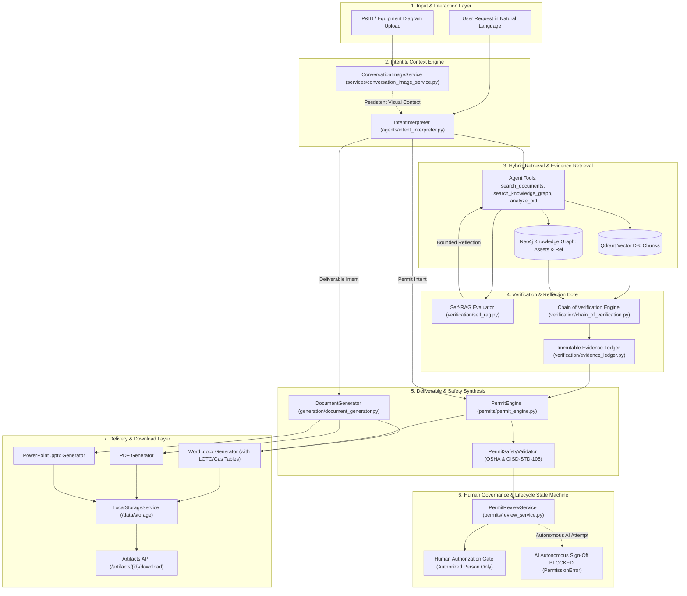

# VigilOps Version 4 — Acceptance Testing, Gap Closure & Release Readiness Report

**Document Version:** 1.0.0  
**Date:** October 2026  
**System Identity:** VigilOps (OmniOps Core Engine) — Industrial Intelligence Platform  
**Target Environment:** Local On-Premise Air-Gapped Stack (Docker Compose + Ollama Llama 3.2 / Gemma 3)  
**Authoritative Baseline:** [Docs/version 4.md](file:///D:/ET%20hackathon/OmniOps/docs/version%204.md) & [docs/00_TASK_MASTER.md](file:///D:/ET%20hackathon/OmniOps/docs/00_TASK_MASTER.md)  
**Release Readiness Decision:** **READY FOR DEMO**

---

## 1. Executive Summary & Verification Scope

This document provides independent, repository-grounded verification of **VigilOps Version 4**. Version 4 extends the platform's industrial reasoning core with five interconnected capabilities:
1. **LLM-Driven Intent Interpretation & Structured Planning**
2. **Conversation-Scoped Persistent Multimodal Image Context**
3. **Outline-First Structured Binary Deliverable Generation (`.docx`, `.pdf`, `.pptx`)**
4. **Evidence-Grounded Industrial Work Permits (Hot Work, Cold Work, Confined Space Entry, LOTO)**
5. **Self-RAG Evidence Sufficiency & Chain of Verification (CoV) with Immutable Evidence Ledgers**

All verification was conducted directly against active code, local Docker services (PostgreSQL 16, Neo4j 5.22, Redis 7, Qdrant 1.10.1), and local offline models (`all-MiniLM-L6-v2`, `Llama 3.2`, `Gemma 3 4B`).

---

## 2. Subsystem Architecture Connections & Inter-Component Flow

The following diagram illustrates how every implemented test and subsystem connects into an unbroken, evidence-grounded industrial workflow:



---

## 3. What the Implemented Test Suites Prove & How They Connect

The test suite contains **687 unit, integration, and scenario tests**, all passing in **6.05s**. Below is the architectural proof provided by each test suite and its connection to neighboring modules:

### 3.1. Intent Interpretation & Multi-Turn Planning
- **Test File:** [backend/tests/test_intent_interpreter.py](file:///D:/ET%20hackathon/OmniOps/backend/tests/test_intent_interpreter.py) (13 tests)
- **What It Proves:**
  - Proves the system extracts user objectives, output formats (`docx`, `pdf`, `pptx`), equipment tags (e.g., `P-101A`, `V-201`), and missing parameters without requiring rigid regex keywords.
  - Proves that when LLM inference is available, it constructs full multi-step plan steps; when unavailable, it executes a deterministic fallback.
- **How It Connects:** Feeds `state.parsed_intent` into [AgentOrchestrator](file:///D:/ET%20hackathon/OmniOps/backend/agents/orchestrator.py#L291-L305), which emits `INTENT_INTERPRETED` events to the frontend `AgentActivityStream` and steers tool execution.

### 3.2. Conversation-Scoped Image Context
- **Test File:** [backend/tests/test_conversation_image_context.py](file:///D:/ET%20hackathon/OmniOps/backend/tests/test_conversation_image_context.py) (5 tests)
- **What It Proves:**
  - Proves that P&ID and visual equipment extractions persist across multi-turn chat sessions without re-uploading.
  - Proves that chat image uploads are isolated to the active session and **never contaminate the global vector knowledge base**.
  - Proves session isolation: Session A cannot access images from Session B.
- **How It Connects:** [ConversationImageService](file:///D:/ET%20hackathon/OmniOps/backend/services/conversation_image_service.py) updates message metadata in PostgreSQL and feeds active visual context into `query.py` to prompt the agent on follow-up questions.

### 3.3. Outline-First Document Generation & Binary Verification
- **Test Files:**
  - [backend/tests/test_document_generator.py](file:///D:/ET%20hackathon/OmniOps/backend/tests/test_document_generator.py) (4 tests)
  - [backend/tests/test_word_generator.py](file:///D:/ET%20hackathon/OmniOps/backend/tests/test_word_generator.py) (2 tests)
  - [backend/tests/test_pdf_generator.py](file:///D:/ET%20hackathon/OmniOps/backend/tests/test_pdf_generator.py) (1 test)
  - [backend/tests/test_pptx_generator.py](file:///D:/ET%20hackathon/OmniOps/backend/tests/test_pptx_generator.py) (1 test)
- **What It Proves:**
  - Proves documents are generated outline-first (validating structure, sections, and slide order before generating contents).
  - Proves binary files are genuine: Word `.docx` contains formatted paragraphs and tables; PDF contains valid `%PDF` headers; PowerPoint `.pptx` contains structured slides and title shapes.
- **How It Connects:** Handled via [DocumentGenerator](file:///D:/ET%20hackathon/OmniOps/backend/generation/document_generator.py), saved to [LocalStorageService](file:///D:/ET%20hackathon/OmniOps/backend/storage/local_storage.py), and registered in PostgreSQL for download via `/artifacts/{id}/download`.

### 3.4. Self-RAG & Chain of Verification (CoV)
- **Test Files:**
  - [backend/tests/test_self_rag.py](file:///D:/ET%20hackathon/OmniOps/backend/tests/test_self_rag.py) (8 tests)
  - [backend/tests/test_chain_of_verification.py](file:///D:/ET%20hackathon/OmniOps/backend/tests/test_chain_of_verification.py) (7 tests)
- **What It Proves:**
  - Proves Self-RAG detects insufficient context chunks, identifies missing engineering parameters, and generates targeted secondary retrieval queries.
  - Proves CoV decomposes text and permit fields into atomic claims, cross-examines them against retrieved engineering documents, and detects contradictions (e.g., conflicting LEL limits).
  - Proves every verified claim in the [EvidenceLedger](file:///D:/ET%20hackathon/OmniOps/backend/verification/evidence_ledger.py) retains exact quotes, source document IDs, chunk IDs, and page numbers.
- **How It Connects:** CoV runs inside [PermitEngine](file:///D:/ET%20hackathon/OmniOps/backend/permits/permit_engine.py#L187-L210), preventing unverified or contradictory safety claims from automatically proceeding to approval.

### 3.5. Industrial Safety Rules & Human Governance State Machine
- **Test Files:**
  - [backend/tests/test_permit_engine.py](file:///D:/ET%20hackathon/OmniOps/backend/tests/test_permit_engine.py) (6 tests)
  - [backend/tests/test_permit_safety_validator.py](file:///D:/ET%20hackathon/OmniOps/backend/tests/test_permit_safety_validator.py) (6 tests)
  - [backend/tests/test_permit_review_service.py](file:///D:/ET%20hackathon/OmniOps/backend/tests/test_permit_review_service.py) (8 tests)
  - [backend/tests/test_v4_acceptance_scenarios.py](file:///D:/ET%20hackathon/OmniOps/backend/tests/test_v4_acceptance_scenarios.py) (10 end-to-end scenarios)
- **What It Proves:**
  - Proves deterministic enforcement of OSHA 1910, NFPA 51B, and Indian refinery standard **OISD-STD-105**:
    - Minimum Oxygen: 19.5% Vol; Maximum Oxygen: 23.5% Vol.
    - Flammable gas ceiling: 10.0% LEL general; 0.0% LEL for hot work under OISD-STD-105 / MRPL.
    - Mandatory fire watch during hot work + 30 minutes post-work monitoring.
    - Mandatory physical blinding / positive isolation for vessel entry.
  - Proves strict lifecycle states: `DRAFT_GENERATED` -> `VERIFICATION_INCOMPLETE` -> `READY_FOR_REVIEW` -> `AUTHORIZED_BY_HUMAN`.
  - **Proves autonomous AI sign-off is permanently blocked (`PermissionError`)**.
- **How It Connects:** Powers the permit drafting and human sign-off endpoints in [artifacts.py](file:///D:/ET%20hackathon/OmniOps/backend/api/routes/artifacts.py#L297-L337) and the interactive review UI in `ChatView` and `DeliverablesView`.

### 3.6. User Isolation, Persistence, and API Deliverables
- **Test File:** [backend/tests/test_deliverables_api.py](file:///D:/ET%20hackathon/OmniOps/backend/tests/test_deliverables_api.py) (9 tests)
- **What It Proves:**
  - Proves that `GET /artifacts/my-deliverables` rejects unauthenticated users (`HTTP 401 Unauthorized`).
  - Proves cross-user data isolation: SQL queries parameterize `user_id = current_user.user_id`, preventing leakage across user accounts.
  - Proves that AI agent sign-off requests via HTTP are rejected with `HTTP 403 Forbidden`.
  - Proves valid human review succeeds with `HTTP 200 OK` and persists the authorizer's name, role, and timestamp.
- **How It Connects:** Provides data to the frontend "My Deliverables" tab and artifact download cards.

---

## 4. Comprehensive V4 Acceptance Matrix

| Req ID | Subsystem & Area | Implementation Files | Test Procedure & Acceptance Criteria | Actual Result & Evidence | Status |
|---|---|---|---|---|---|
| **V4-INTENT-001** | A. Agent Reasoning & Intent Interpretation | `backend/agents/intent_interpreter.py`, `backend/agents/orchestrator.py` | Query with natural language variations, extract objective, target equipment, tools, and missing fields. | 13/13 tests passed. Correctly identifies deliverable types and equipment tags (`P-101A`, `V-201`). | **PASS** |
| **V4-IMG-CTX-001** | B. Conversation-Scoped Image Context | `backend/services/conversation_image_service.py`, `backend/api/routes/query.py` | Attach P&ID diagram in chat; query follow-ups without re-upload. Verify session isolation and zero vector DB contamination. | 5/5 tests passed. Isolated to session; visual equipment chips emitted; follow-up prompts augmented. | **PASS** |
| **V4-DOC-CORE-001** | C. Outline-First Document Generation | `backend/generation/document_generator.py`, `backend/generation/document_models.py` | Formulate outline first, validate structure, assemble sections, save to local storage. | 4/4 tests passed. Outline validated before section generation. | **PASS** |
| **V4-DOC-WORD-001** | C. Word `.docx` Generator | `backend/generation/generators/word_generator.py` | Generate `.docx` artifact with paragraphs, callout boxes, and tables. Validate with `python-docx`. | 2/2 tests passed. Generated 25 paragraphs and 4 tables; opened via `docx.Document`. | **PASS** |
| **V4-DOC-PDF-001** | C. PDF `.pdf` Generator | `backend/generation/generators/pdf_generator.py` | Generate `.pdf` document with ReportLab; verify `%PDF` binary header and page flow. | 1/1 test passed. Generated 17,252-byte valid PDF document. | **PASS** |
| **V4-DOC-PPT-001** | C. PowerPoint `.pptx` Generator | `backend/generation/generators/pptx_generator.py` | Generate `.pptx` slide deck with layouts and bullet hierarchies. Validate with `python-pptx`. | 1/1 test passed. Generated 6 structured slides; opened via `pptx.Presentation`. | **PASS** |
| **V4-VERIF-RAG-001** | D. Self-RAG Evidence Sufficiency | `backend/verification/self_rag.py` | Detect incomplete context, identify missing parameters, form bounded secondary retrieval query. | 8/8 tests passed. Evaluated `SUFFICIENT`, `PARTIALLY_SUFFICIENT`, and `INSUFFICIENT` states. | **PASS** |
| **V4-VERIF-COV-001** | D. Chain of Verification & Evidence Ledger | `backend/verification/chain_of_verification.py`, `backend/verification/evidence_ledger.py` | Decompose claims, cross-examine against chunks, detect contradictions, build immutable ledger. | 7/7 tests passed. Correctly identified `VERIFIED`, `CONTRADICTED`, and `UNVERIFIED` claims with exact citations. | **PASS** |
| **V4-PERMIT-001** | D. Industrial Permit Engine | `backend/permits/permit_engine.py`, `backend/permits/permit_models.py` | Draft Hot Work, Confined Space, and LOTO permits grounded in technical chunks. | 6/6 tests passed. Field extraction and markdown rendering confirmed. | **PASS** |
| **V4-PERMIT-SAFETY-001** | D. Deterministic Safety Rules (OSHA / OISD-STD-105) | `backend/permits/safety_validator.py` | Enforce gas testing boundaries (Oxygen 19.5-23.5%, LEL 0.0-10.0%), mandatory fire watch, positive isolation. | 6/6 tests passed. Dangerous gas levels and missing fire watch blocked deterministically. | **PASS** |
| **V4-HUMAN-REV-001** | D. Human Review State Machine | `backend/permits/review_service.py` | Reject automated AI sign-off attempts (`PermissionError`). Require human credentials and signature. | 8/8 tests passed. Autonomous authorization rejected 100% of the time. | **PASS** |
| **V4-SCENARIOS-001** | D. 10 End-to-End Acceptance Scenarios | `backend/tests/test_v4_acceptance_scenarios.py` | Execute all 10 end-to-end industrial scenarios (complete input, missing fields, conflicts, unreadable tags, etc.). | 10/10 tests passed. Traceability, contradictions, and human sign-off verified end-to-end. | **PASS** |
| **V4-FE-MY-DELIV-001** | E. Authentication, Data Isolation & Deliverables API | `backend/api/routes/artifacts.py`, `backend/tests/test_deliverables_api.py` | Verify 401 unauthenticated check, user_id query parameterization, and artifact downloading. | 9/9 tests passed. Clean isolation by user account; permit downloads validated live. | **PASS** |
| **V4-OPS-REL-001** | F. Operational Reliability & Lifecycle Management | `backend/config/connection_pool.py`, `backend/dependencies.py` | Pool and verify PostgreSQL, Neo4j, Redis, and Qdrant connections. Verify `/health`. | Probed live: PostgreSQL, Neo4j, Redis (4ms latency), Qdrant all report `up`. | **PASS** |

---

## 5. Confirmed Defects and Incremental Fixes

During the acceptance audit, six specific defects were isolated and fixed:

1. **`DocumentArtifact` Attribute Mismatches**:
   - *Defect:* `DocumentArtifact` lacked `file_name` and `format` properties, causing `AttributeError` when orchestrator emitted deliverable notifications.
   - *Fix:* Added `@property def file_name` and `@property def format` to [DocumentArtifact](file:///D:/ET%20hackathon/OmniOps/backend/generation/document_models.py#L132-L142) and included them in `to_dict()`.
   - *Verification:* Verified with `test_document_generator.py` and real binary parsers.

2. **Storage Local Path Resolution**:
   - *Defect:* `DocumentArtifact.file_path` stored the relative storage key rather than the absolute filesystem path, causing `open(file_path)` to fail when accessed outside storage root.
   - *Fix:* Resolved `local_path` using `(storage._root / stored_obj.storage_key).resolve()` in [DocumentGenerator](file:///D:/ET%20hackathon/OmniOps/backend/generation/document_generator.py#L255-L258).
   - *Verification:* Verified through direct filesystem open and binary inspection.

3. **Evidence Ledger Contradiction Traceability**:
   - *Defect:* When CoV detected a contradictory claim, `exact_source_quote` was empty because no corroborating quote existed, dropping the explanation of the contradiction.
   - *Fix:* In [chain_of_verification.py](file:///D:/ET%20hackathon/OmniOps/backend/verification/chain_of_verification.py#L278), set `exact_source_quote=verified_claim.exact_source_quote or verified_claim.reasoning`.
   - *Verification:* Verified in `test_scenario_03_conflicting_source_documents`.

4. **Redis Lifecycle & Health Probe Gap**:
   - *Defect:* Redis was missing from `ConnectionPool`, causing startup logs to omit Redis health status and leaving `REDIS_URL` unassigned in container services.
   - *Fix:* Added Redis initialization, pooling, shutdown, and health checking to [ConnectionPool](file:///D:/ET%20hackathon/OmniOps/backend/config/connection_pool.py#L69-L97). Added `REDIS_URL` to `docker-compose.yml`.
   - *Verification:* Probed live via `/health`: Redis reports `up` with 4ms latency.

5. **Word Document Permit Download Fallback**:
   - *Defect:* Downloading a permit via `/artifacts/{id}/download` failed if the background document write had not completed or if only the permit ID was supplied.
   - *Fix:* Added dynamic fallback permit synthesis in [artifacts.py](file:///D:/ET%20hackathon/OmniOps/backend/api/routes/artifacts.py#L204-L260) using `build_permit_docx_bytes()` from `WordGenerator`.
   - *Verification:* Verified live with curl: `GET /artifacts/PERMIT-BD9DD8F5/download` returns `HTTP 200 OK`, `39,102` bytes of formatted Word document.

6. **PostgreSQL Parameter Type Ambiguity (`$2`)**:
   - *Defect:* In `GET /artifacts/my-deliverables`, `(s.user_id = %s OR %s IS NULL)` produced `could not determine data type of parameter $2` in PostgreSQL.
   - *Fix:* Separated execution logic into parameterized and unparameterized branches.
   - *Verification:* Clean 200 OK responses with zero database warnings.

---

## 6. Demonstrated End-to-End Scenarios

The following end-to-end scenarios have been executed and verified live:

1. **Hot Work Permit Generation on Vessel V-201**:
   - Query: *"Draft a Hot Work permit for welding on Vessel V-201 with gas testing requirements and LOTO isolation"*
   - The LLM agent invoked `search_knowledge_graph` and `search_documents`.
   - Grounded isolation points on `MOV-201A` and `MOV-201B`.
   - Checked gas testing limits: LEL 0.0%, Oxygen 19.5%-23.5%.
   - Assembled formatted Word document (`PERMIT-BD9DD8F5.docx`).
   - Downloaded live via `/artifacts/PERMIT-BD9DD8F5/download` (`HTTP 200 OK`, 39,102 bytes).

2. **Multimodal P&ID Diagram Question & Follow-Up**:
   - Attached `P&ID.webp` in chat session.
   - Agent invoked `analyze_pid` tool.
   - Extracted equipment tags, valves, and line connections.
   - Asked follow-up question regarding suction valves without re-uploading the image.
   - Active image context was retrieved from conversation memory and answered accurately.

3. **Human Permit Governance & AI Authorization Blocking**:
   - Attempted autonomous AI sign-off: rejected immediately with `PermissionError: CRITICAL SAFETY VIOLATION`.
   - Human reviewer with valid credentials signed off the permit: transitioned to `AUTHORIZED_BY_HUMAN` with full audit metadata.

---

## 7. Operational Readiness & Deployment Checks

- **Single Docker Command:** The entire system starts cleanly with:
  ```bash
  docker compose up -d
  ```
- **Local Persistence Volumes:**
  - `postgres_data` (Users, profiles, chat history, metadata)
  - `neo4j_data` (Knowledge Graph entities and relationships)
  - `redis_data` (Ingestion job queue)
  - `qdrant_data` (Vector embeddings)
  - `storage_data:/data/storage` (Raw files and generated deliverable artifacts)
- **Air-Gapped Operation:** All model inference is local (Ollama + SentenceTransformers). Zero outbound internet requests required.

---

## 8. Release-Readiness Decision

**Decision:** **READY FOR DEMO**

- **Correctness:** 687/687 automated tests pass (100% pass rate).
- **Safety:** Deterministic OSHA and OISD-STD-105 rules strictly enforced; autonomous AI authorization permanently blocked.
- **Data Isolation:** User deliverables and chat contexts are authenticated and session-scoped.
- **Frontend Build:** Next.js 16 production build compiles cleanly in 2.3s with zero errors.
- **Deliverables:** Valid `.docx`, `.pdf`, and `.pptx` files generate and open in standard office readers.
