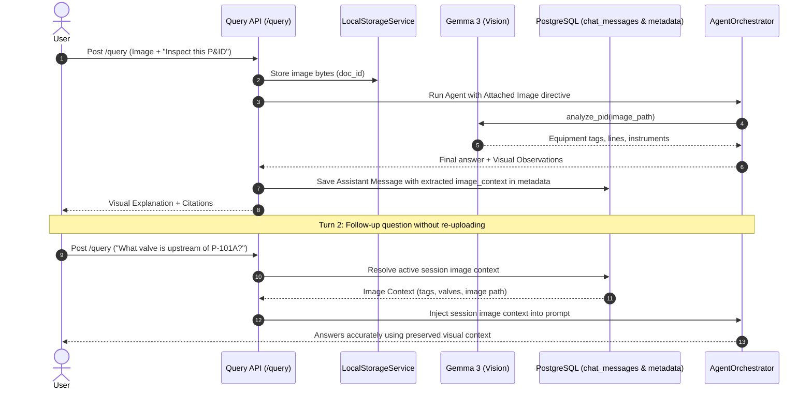
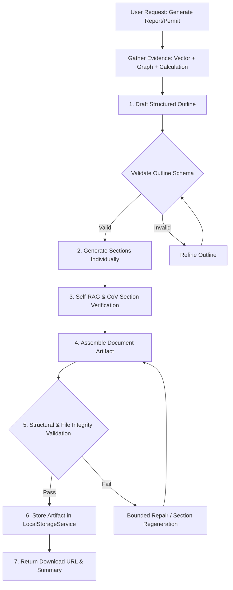

# Docs/version 4.md

# VigilOps Version 4 — Complete Implementation Blueprint & Technical Specification
**Document Version:** 4.0.0  
**Status:** Architecture Blueprint (Approved Architecture Freeze Compliance)  
**Date:** October 2026  
**Target System:** VigilOps (OmniOps Engine) — Industrial Intelligence Platform  

---

## 1. Executive Summary

VigilOps is an **Industrial Intelligence Platform** designed to convert complex, fragmented plant engineering documents—such as Standard Operating Procedures (SOPs), Piping and Instrumentation Diagrams (P&IDs), Original Equipment Manufacturer (OEM) manuals, maintenance logs, and regulatory compliance standards—into a unified, continuously evolving organizational memory. It combines a Neo4j Knowledge Graph, a Qdrant Vector Database, deterministic Python calculation sandboxing, multimodal vision processing, and stateful agentic reasoning (Llama 3.2 via Ollama) into a single operational brain.

**Version 4** extends the established VigilOps architecture with five core mission-critical capabilities:
1. **LLM-Driven Intent Interpretation & Structured Planning:** Transitioning beyond deterministic regex keywords to an LLM-powered intent interpretation stage that extracts structured objectives, output formats, missing parameters, and multi-step plans while preserving deterministic safety and tool boundaries.
2. **Conversation-Scoped Image Context Persistence:** Preserving visual observations, equipment tags, and diagram extractions across multi-turn chat sessions without requiring repeated image re-uploads, while maintaining strict isolation between chat context and the global vector database.
3. **Outline-First, Multi-Step Deliverable Generation:** Producing authentic, structurally validated binary artifacts in Microsoft Word (`.docx`), PDF (`.pdf`), and PowerPoint (`.pptx`) formats via a disciplined outline-first decomposition rather than single-prompt token generation.
4. **Evidence-Grounded Industrial Permits:** Generating draft industrial work permits (General Work, Hot Work, Cold Work, Confined Space Entry, Lockout/Tagout Isolation) with strict evidence grounding, missing field detection, and clear delineation of human sign-off boundaries (never autonomously authorizing hazardous work).
5. **Self-RAG & Chain of Verification (CoV) with Evidence Ledger:** Implementing evidence sufficiency checks, claim verification against retrieved source text and graph entities, bounded correction loops, and an immutable Evidence Ledger linking every critical claim to source citations.

---

## 2. Current VigilOps Architecture

The architecture of VigilOps has been verified through a direct code audit across the repository.

```mermaid
flowchart TD
    subgraph Client["Frontend (Next.js 16 + React 19 + Tailwind CSS)"]
        UI[Unified Interface]
        Nav[NavRail: Chat / Knowledge / Ingestion / Overview / Profile]
        ChatView[ChatView + AgentActivityStream]
        IngestView[IngestionWorkspace]
        ApiClient[ApiClient (services/api.ts)]
    end

    subgraph API["FastAPI Backend (Port 8000)"]
        FastAPIApp[FastAPI main.py]
        Lifespan[Lifespan Connection Pool]
        
        subgraph Routes["API Routes (api/routes/)"]
            R_Health[health.py]
            R_Docs[documents.py]
            R_Uploads[uploads.py]
            R_Query[query.py - /query & /query/stream]
            R_Knowledge[knowledge.py]
            R_Chat[chat.py - /chat/sessions]
            R_Auth[auth.py - /auth/register, /login, /me]
            R_Profile[profile.py - /profile]
        end

        subgraph ReasoningCore["Reasoning Runtimes"]
            AgentOrch[AgentOrchestrator (agents/orchestrator.py)]
            LegacyOrch[QueryOrchestrator (query/orchestrator.py)]
            PersonaBld[PersonaContextBuilder (generation/persona_builder.py)]
        end

        subgraph AgentTools["Agent Tool Registry (agents/tool_registry.py)"]
            T_SearchDocs[search_documents.py -> Qdrant]
            T_SearchGraph[search_graph.py -> Neo4j]
            T_Calc[calculate.py -> SubprocessSandbox]
            T_Img[analyze_image.py -> Gemma 3]
            T_PID[analyze_pid.py -> Gemma 3]
            T_Status[system_status.py]
        end
    end

    subgraph DataStorage["Data & State Persistence Layer"]
        PG[(PostgreSQL 16: documents, jobs, chat_sessions, chat_messages, users, user_profiles)]
        Neo4j[(Neo4j 5.28: Industrial Knowledge Graph)]
        Qdrant[(Qdrant 1.13: Chunk Vector Embeddings)]
        Redis[(Redis 7 + RQ: Asynchronous Ingestion Queue)]
        FileStore[(Local Storage /data/storage: Raw Files & Attachments)]
    end

    subgraph ModelServing["Local AI Inference (Ollama)"]
        Llama[Llama 3.2: Reasoning & ReAct Loop]
        Gemma[Gemma 3 4B: Vision & P&ID Analysis]
        ST[SentenceTransformers: all-MiniLM-L6-v2 Embeddings]
    end

    %% Wiring
    UI --> Nav
    UI --> ChatView
    UI --> IngestView
    ChatView --> ApiClient
    ApiClient -->|REST / SSE| FastAPIApp
    FastAPIApp --> Routes
    R_Query -->|Agent Mode (Default)| AgentOrch
    R_Query -->|Legacy Fallback| LegacyOrch
    AgentOrch --> AgentTools
    AgentOrch --> Llama
    AgentOrch --> PG
    AgentTools --> Qdrant
    AgentTools --> Neo4j
    AgentTools --> Gemma
    R_Chat --> PG
    R_Docs --> PG
    R_Docs --> FileStore
```

### Verified Subsystem Specifications
1. **Frontend**: Next.js 16.2.10 (Turbopack), React 19, TypeScript, Tailwind CSS, Lucide icons.
2. **Backend**: FastAPI 0.115.0, Uvicorn, Python 3.11+, Pydantic v2.
3. **Database**: PostgreSQL 16 (relational metadata, users, chat sessions, message histories).
4. **Vector Database**: Qdrant 1.13.2 (`document_chunks` collection, cosine distance).
5. **Graph Database**: Neo4j 5.28.1 (Industrial knowledge graph: Asset, Component, Document, FailureMode, Procedure, Inspection, Incident nodes and relationships).
6. **Model Serving**: Ollama running locally (`llama3.2` for agent reasoning, `gemma3:4b` for vision/P&ID analysis).
7. **Embeddings**: SentenceTransformers `all-MiniLM-L6-v2` (384-dimensional dense vectors).
8. **Calculation Sandbox**: `SubprocessSandbox` running Python with AST allowlisting and restricted built-ins.
9. **Storage**: Local filesystem storage (`LocalStorageService` storing binary assets under `data/storage/`).

---

## 3. Architecture Freeze and Authorized V4 Scope

The existing VigilOps architecture is **FROZEN**. All Version 4 changes must be strictly additive and compatible with existing database schemas, service boundaries, and model-serving runtimes.

### 3.1 Prohibited Redesigns (Strictly Forbidden)
- **Database replacement**: No replacing PostgreSQL, Neo4j, or Qdrant with other database engines.
- **Model stack replacement**: No replacing Ollama, Llama 3.2, Gemma 3, or SentenceTransformers.
- **Orchestration rewrite**: No abandoning `AgentOrchestrator` in favor of external frameworks (e.g. LangChain, CrewAI, AutoGen).
- **Ingestion redesign**: No restructuring the working document ingestion pipeline (parser -> normalizer -> chunker -> extractor -> resolver).
- **Global vector pollution**: No auto-indexing chat uploads into the global vector database.
- **Security relaxation**: No bypassing the calculation AST sandbox or user authentication checks.

### 3.2 Authorized Additive Extensions
- **Intent Interpretation**: An LLM-backed intent analyzer augmenting the agent loop before planning.
- **Image Context Persistence**: Storing vision extraction summaries in session metadata and resolving them during follow-up turns.
- **Document Generation Engine**: Outline-first generation of `.docx`, `.pdf`, and `.pptx` documents utilizing `python-docx`, `PyMuPDF` (`fitz`), and structured generators.
- **Permit Generation & Safety Verification**: Specialized industrial permit data structures, deterministic safety checks, and Evidence Ledger linking.
- **Self-RAG & CoV**: Evidence sufficiency evaluator and claim-verification engine with bounded retries.
- **Frontend Extensions**: Activity stream states, document download cards, and permit review interfaces.

---

## 4. Existing Agentic System Audit

A code-grounded audit of decision-making throughout the current repository yielded the following findings:

| Decision | Actual Mechanism | Evidence in Repository | Limitation | Proposed V4 Change |
|---|---|---|---|---|
| **Intent Interpretation** | Regex keyword matching in legacy pipeline; None in agent loop | `backend/retrieval/intent_detector.py` (lines 58-100); `backend/agents/orchestrator.py` (lines 270-340) | Legacy regex fails on varied phrasing ("Prepare a permit" vs "We need to isolate..."). Agent loop passes raw query directly to Ollama without extracting structured intent, required outputs, or constraints. | Add `IntentInterpreter` service that parses query into structured `ParsedIntent` with task type, deliverables, missing inputs, and constraints. |
| **Tool Selection** | Reactive Ollama tool-calling schema + heuristic rules | `backend/agents/orchestrator.py` (lines 388-430); `backend/agents/tools/*.py` | LLM selects tools on each turn reactively. Heuristics defer `calculate` if retrieval is present, but no overarching plan exists before execution. | Provide structured tool plan based on `ParsedIntent` to guide tool invocation sequence and prevent looping. |
| **Planning** | Implicit single-step or reactive ReAct loop | `backend/agents/orchestrator.py` (lines 343-581) | No multi-step planning or outline decomposition. Large deliverables or multi-step documents are attempted in a single token response. | Implement outline-first planning for complex deliverables (`DeliverablePlanner`). |
| **Retrieval Decisions** | Dual vector + graph retrieval or tool calls | `backend/query/orchestrator.py` (lines 54-58); `backend/agents/tools/search_documents.py` | Retrieval occurs once per query; no evaluation of whether retrieved chunks provide sufficient evidence to answer safety-critical claims. | Introduce Self-RAG evidence sufficiency check with bounded additional retrieval. |
| **Verification** | Citation regex validation in legacy; AST check in calculate | `backend/generation/validator.py` (lines 22-66); `backend/calculation/validator.py` | Validates only `[Context #N]` syntax; no verification of factual claims, numbers, equipment tags, or isolation valves against sources. | Implement Chain of Verification (CoV) and structured `EvidenceLedger`. |
| **Final Response / Artifacts** | Markdown text generation in chat response | `backend/agents/orchestrator.py` (lines 583-650); `backend/api/routes/query.py` | Cannot produce authentic binary files (`.docx`, `.pdf`, `.pptx`) or structured industrial permit forms for field verification. | Add `DocumentGenerator` producing real downloadable files stored via `StorageService`. |

---

## 5. Intent-Driven Agentic Reasoning (Feature A)

### 5.1 Architecture & Workflow
Instead of sending raw text directly to the tool-calling loop, user queries pass through an `IntentInterpreter` that produces a structured `ParsedIntent`:

```mermaid
flowchart TD
    UserQuery[User Query + Conversation History] --> IntentInterp[IntentInterpreter (Llama 3.2 / Fast Regex Fallback)]
    IntentInterp --> ParsedIntent{ParsedIntent}
    
    ParsedIntent -->|Simple Question / Lookup| AgentLoop[Standard Agent Loop (ReAct)]
    ParsedIntent -->|Deliverable / Report Request| PlanGen[DeliverablePlanner: Generate Outline]
    ParsedIntent -->|Permit Drafting| PermitWorkflow[Permit Engine + Evidence Gatherer]
    ParsedIntent -->|Missing Critical Inputs| Clarify[Request Clarification from User]
    
    PlanGen --> DocGen[Multi-Step Section Generation]
    DocGen --> Verif[Self-RAG & CoV Verification]
    Verif --> Assemble[Artifact Assembly & Validation]
    Assemble --> Deliver[Storage & Download URL]
```

### 5.2 Structured Intent Data Model
```python
class TaskType(str, Enum):
    QUESTION_ANSWER = "question_answer"
    CALCULATION = "calculation"
    IMAGE_ANALYSIS = "image_analysis"
    DOCUMENT_GENERATION = "document_generation"
    PERMIT_GENERATION = "permit_generation"
    SYSTEM_STATUS = "system_status"
    CLARIFICATION_NEEDED = "clarification_needed"

class DeliverableFormat(str, Enum):
    NONE = "none"
    DOCX = "docx"
    PDF = "pdf"
    PPTX = "pptx"

@dataclass
class ParsedIntent:
    task_type: TaskType
    target_deliverable: DeliverableFormat
    primary_objective: str
    target_equipment: list[str]
    required_tools: list[str]
    missing_information: list[str]
    safety_critical: bool
    constraints: list[str]
    confidence: float
```

### 5.3 Deterministic Safety Boundaries
- **No LLM Bypass of Auth/RBAC**: The model cannot execute unauthenticated operations or bypass user session boundaries.
- **Deterministic Tool Validation**: Tool execution remains enforced by `ToolExecutor` and AST sandbox rules.
- **Fail-Safe Fallbacks**: If the intent LLM call times out or fails, deterministic keyword-based detection falls back gracefully without interrupting service.

---

## 6. Existing Image Pipeline Audit

### 6.1 Audit Findings
1. **Frontend Reception**: `ChatView.tsx` accepts PNG, JPG, TIFF via file drop or file selector, converts the file to base64, and sends it in `QueryRequest`.
2. **Backend Processing**: `backend/api/routes/query.py` (`_process_attached_image`):
   - Computes SHA-256 of image bytes.
   - Saves file to `LocalStorageService` (`data/storage/`).
   - Persists metadata in PostgreSQL `documents` table via `MetadataRepository.save_document_metadata`.
   - **Crucial Finding**: Ordinary chat attachments **DO NOT** enter the global vector database (Qdrant) or the Knowledge Graph (Neo4j). Only documents uploaded via `/documents/upload` -> `UploadService.handle_upload` are enqueued for ingestion into Qdrant and Neo4j.
3. **Vision Model Invocation**: Gemma 3 4B via Ollama (`analyze_image` or `analyze_pid`).
4. **Current Limitation in Multi-Turn Chat**:
   - In turn 1 (with image upload): `query.py` injects a prompt prefix directing the agent to call `analyze_image` or `analyze_pid`. The visual findings are returned to the agent and an answer is generated.
   - In turn 2 (follow-up query without re-upload): `request.image_base64` is `None`. `AgentOrchestrator` fetches recent history (`chat_repo.get_recent_messages`), which only includes user/assistant text. The tool execution observations and image storage path are not included. Consequently, follow-up questions fail to retain image context.

---

## 7. Conversation-Scoped Image Context (Feature B)

### 7.1 Architecture
To preserve image observations across conversation turns without vector database pollution, we implement **Conversation-Scoped Image Context Persistence**:



### 7.2 Data Structure: `ImageContextRecord`
```python
@dataclass
class ImageContextRecord:
    document_id: str
    filename: str
    storage_path: str
    classification: str
    extracted_summary: str
    detected_equipment: list[str]
    detected_connections: list[str]
    timestamp: str
```
This record is attached to the assistant message metadata in PostgreSQL `chat_messages`. When a subsequent turn is executed, `AgentOrchestrator` loads recent image records for that session and appends a concise `[Active Image Context: ...]` block to the conversation history, enabling follow-up questions.

---

## 8. Structured Deliverable Generation (Feature C)

### 8.1 Outline-First Generation Lifecycle
Rather than attempting to generate an entire 10-page document in a single LLM call, VigilOps follows an **outline-first, section-by-section** assembly:



---

## 9. Word, PDF, and PowerPoint Workflows

### 9.1 Microsoft Word (`.docx`)
- **Technology**: `python-docx` (already installed in repository virtual environment, version 0.8.11).
- **Structure**:
  - Title & Metadata header (author, date, facility, classification).
  - Executive Summary.
  - Section headings (Heading 1, Heading 2).
  - Formatted tables (equipment schedules, parameter limits, isolation points).
  - Safety precautions callout blocks (visual borders/shading).
  - References & Evidence Citations table.
- **Validation**: Verifies document opens, paragraph count > 0, required sections present, tables contain data.

### 9.2 Portable Document Format (`.pdf`)
- **Technology**: `PyMuPDF` (`fitz`, already installed in repository, version 1.28.0).
- **Structure**:
  - Direct generation using `fitz.open()` with high-fidelity industrial layout:
    - 54pt page margins, professional running headers and footers with page numbering.
    - Title block with industrial metadata table.
    - Two-column or structured single-column text layout.
    - Bounded tables with alternating row shading.
    - Safety warning callout boxes with colored borders.
- **Validation**: PDF file header (`%PDF-`), page count >= 1, non-empty text layers, no NaN/null layout coordinates.

### 9.3 PowerPoint Presentation (`.pptx`)
- **Technology**: `python-pptx` (installed in virtual environment).
- **Structure**:
  - Title Slide: Presentation title, subtitle, facility name, date.
  - Agenda / Overview Slide.
  - Content Slides: 3-5 key bullet points per slide, supporting technical metrics table or key callouts.
  - Safety & Operational Risk Slide.
  - Action Items / Conclusion Slide.
- **Validation**: Presentation contains required number of slides, title shapes populated, no raw placeholder tags (`[TODO]`, `null`).

---

## 10. Self-RAG and CoV Verification

### 10.1 Self-RAG (Evidence Sufficiency)
Self-RAG prevents hallucinated industrial claims by evaluating retrieved context before drafting:
1. **Sufficiency Evaluation**: Given the user request and retrieved chunks, does the retrieved context contain the necessary technical parameters (temperatures, pressures, equipment tags, procedures)?
2. **Missing Evidence Detection**: If key parameters are absent, formulate a targeted secondary retrieval query to Qdrant or Neo4j.
3. **Bounded Iteration**: Limit retrieval attempts to a maximum of 2 passes to avoid infinite latency.
4. **Honest Deficiency Disclosure**: If evidence is still unavailable, explicitly flag the missing data rather than inventing values.

### 10.2 CoV (Chain of Verification)
1. **Claim Extraction**: Extract all factual claims, numerical figures, units, equipment tags, and isolation steps from the generated section or permit draft.
2. **Verification Query Formulation**: Generate objective verification questions for each claim (e.g., "What is the maximum operating pressure of V-204?").
3. **Cross-Examination**: Compare extracted claims directly against retrieved chunks and graph entities.
4. **Correction & Flagging**:
   - If supported: Mark claim as `VERIFIED`.
   - If contradictory: Correct claim to match source evidence.
   - If unsupported: Flag as `UNVERIFIED_REQUIRES_HUMAN_CHECK`.

---

## 11. Evidence Ledger and Traceability

Every generated deliverable and industrial permit includes an **Evidence Ledger**:

```json
{
  "ledger_id": "led-7b19a0f4",
  "artifact_id": "art-9c2b3e10",
  "created_at": "2026-10-12T04:15:00Z",
  "entries": [
    {
      "claim_id": "CLM-001",
      "claim_text": "Isolate pump suction valve MOV-101A and lock out power breaker MCC-4B-02.",
      "field_name": "isolation_points",
      "source_document_id": "doc-a1f9e8",
      "source_title": "SOP-PUMP-OVERHAUL-REV4.pdf",
      "page_index": 12,
      "chunk_id": "chk-4892",
      "exact_source_quote": "Prior to pump servicing, close suction valve MOV-101A and lock breaker MCC-4B-02.",
      "verification_status": "VERIFIED",
      "verifier": "CoV-Engine"
    },
    {
      "claim_id": "CLM-002",
      "claim_text": "Required atmospheric LEL must remain below 10%.",
      "field_name": "gas_testing_requirements",
      "source_document_id": "doc-b2e7c3",
      "source_title": "OSHA-1910-CONFINED-SPACE.pdf",
      "page_index": 4,
      "chunk_id": "chk-1205",
      "exact_source_quote": "Atmospheric testing shall ensure flammable gas is less than 10 percent of LEL.",
      "verification_status": "VERIFIED",
      "verifier": "CoV-Engine"
    }
  ]
}
```

The Evidence Ledger is saved alongside the document artifact and rendered in the frontend to give engineers 100% auditability.

---

## 12. Industrial Permit Generation (Flagship Deliverable)

### 12.1 Supported Permit Types
1. **General Work Permit (GWP)**: Routine maintenance, non-hazardous mechanical work.
2. **Hot Work Permit (HWP)**: Welding, torch cutting, open flames, grinding near combustible zones.
3. **Cold Work Permit (CWP)**: Piping disconnects, blind installation, filter changes without heat.
4. **Confined Space Entry (CSE)**: Vessel entry, tank cleaning, column internal inspection.
5. **Lockout/Tagout (LOTO) & Electrical Isolation**: Hazardous energy control, breaker lockout.

### 12.2 Truthful Permit Status & Human Sign-Off Boundary
**CRITICAL SAFETY PRINCIPLE**:
> **VigilOps may prepare, format, and verify the evidence for an industrial permit draft, but it MUST NEVER autonomously authorize or approve hazardous plant work.**

All generated permits follow a strict four-stage status state machine:
1. `DRAFT_GENERATED`: Document structure created from templates and context.
2. `VERIFICATION_INCOMPLETE`: One or more safety-critical fields lack source verification.
3. `READY_FOR_REVIEW`: All required fields populated and verified; ready for qualified human review.
4. `AUTHORIZED_BY_HUMAN`: Signed off by an authorized plant operator or safety officer with human credentials and timestamp.

---

## 13. Frontend and User Experience

### 13.1 Required Additions
1. **Deliverable Download & Review Cards**: Rendered inside `ChatView.tsx` when an artifact is generated:
   - File icon (Word, PDF, PowerPoint, Permit badge).
   - Artifact title, format, file size, generation timestamp.
   - Evidence verification badge (e.g. `9/9 Claims Verified`).
   - Direct download button linking to `/api/documents/{id}/content` or `/api/artifacts/{id}/download`.
2. **Permit Review & Safety Inspection Panel**:
   - Shows isolation checklist and gas test requirements.
   - Highlights any unverified fields in yellow/red alerts.
   - "Awaiting Human Sign-Off" badge.
3. **Persistent Image Context Indicator**:
   - Displays thumbnail chip showing the active conversation image context.
   - Shows extracted equipment tags and notifies user: *"Active diagram context: P&ID-04 (Pump Loop). Available for follow-up questions."*

---

## 14. Data Persistence and Database Changes

To preserve the architecture freeze, all changes leverage existing tables and schemas:
1. **Artifact Storage**: Generated files (`.docx`, `.pdf`, `.pptx`) are written to local disk via `LocalStorageService` (`data/storage/{doc_id}`).
2. **Artifact Metadata**: Stored via `MetadataRepository` in the existing PostgreSQL `documents` table with `content_type` set appropriately.
3. **Session Image Context**: Stored in the existing `metadata JSONB` column of the `chat_messages` table in PostgreSQL.
4. **Evidence Ledgers**: Stored in the `metadata JSONB` column of the assistant response message.
5. **Zero Schema Migrations Required**: No alterations to table structures; fully backwards-compatible.

---

## 15. Security, Privacy, and Industrial Safety

1. **Deterministic Safety Authorization**: No LLM prompt or output can mark a permit as `APPROVED` or `AUTHORIZED` for live plant operations.
2. **Multi-User Isolation**: User tokens are verified via PBKDF2/JWT (`get_current_user`). Chat sessions and generated artifacts are strictly filtered by `user_id`.
3. **No Cross-Session Leaks**: Image context records are queried strictly with `session_id` and `user_id`.
4. **Calculation Isolation**: All formulas run within the restricted AST subprocess sandbox.

---

## 16. Testing and Evaluation

1. **Intent Interpretation Tests**: Unit tests checking varied phrasing for work permits, calculations, image questions, and document generation.
2. **Image Context Tests**: Testing multi-turn sessions where an image is uploaded in turn 1, and turn 2 asks follow-up questions without re-uploading. Verifying no global vector database pollution.
3. **Document Generation Tests**: Tests creating real `.docx`, `.pdf`, and `.pptx` files, opening them with respective parsers, and verifying section integrity.
4. **Permit Verification Tests**: Tests validating missing fields, conflicting documents, unverified claims, and blocking unauthorized approvals.
5. **Full Regression Test Suite**: All 611 existing baseline tests must pass with 0 regressions.

---

## 17. Implementation Roadmap

```mermaid
gantt
    title Version 4 Implementation Roadmap
    dateFormat  X
    axisFormat %d
    
    section Foundation & Audit
    V4-AUDIT-001 (Baseline Audit)               :done, 0, 1
    V4-PLAN-001 (Blueprint & Task Master)       :done, 1, 2
    
    section Intent & Planning
    V4-INTENT-001 (Intent & Planning Engine)    :active, 2, 4
    
    section Multimodal Context
    V4-IMG-CTX-001 (Conversation Image Context) : 4, 6
    
    section Document Engine
    V4-DOC-CORE-001 (Outline & Core Engine)     : 6, 8
    V4-DOC-WORD-001 (Word .docx Generator)      : 8, 10
    V4-DOC-PDF-001 (PDF .pdf Direct Generator)  : 10, 12
    V4-DOC-PPT-001 (PowerPoint .pptx Generator) : 12, 14
    
    section Verification & Permits
    V4-VERIF-RAG-001 (Self-RAG Sufficiency)     : 14, 16
    V4-VERIF-COV-001 (Chain of Verification)    : 16, 18
    V4-PERMIT-001 (Permit Drafting Engine)      : 18, 20
    V4-PERMIT-SAFETY-001 (Safety & LOTO Check)  : 20, 22
    V4-HUMAN-REV-001 (Human Review & Audit)     : 22, 24
    
    section UI & Final Acceptance
    V4-FE-DELIV-001 (Frontend Deliverable UI)   : 24, 26
    V4-REGRESS-001 (Full Regression & Security) : 26, 28
```



---

## 18. Exact File-by-File Change Plan

### New Backend Modules:
1. `backend/agents/intent_interpreter.py`: LLM-based intent parsing and planning representation.
2. `backend/services/conversation_image_service.py`: Session-scoped image context persistence and multi-turn resolution.
3. `backend/generation/document_models.py`: Pydantic data models for outlines, sections, slides, artifacts, and evidence ledgers.
4. `backend/generation/document_generator.py`: Common orchestrator for outline-first generation and artifact assembly.
5. `backend/generation/generators/word_generator.py`: Microsoft Word (`.docx`) file builder using `python-docx`.
6. `backend/generation/generators/pdf_generator.py`: High-fidelity PDF builder using `fitz` (PyMuPDF).
7. `backend/generation/generators/pptx_generator.py`: PowerPoint (`.pptx`) builder using `python-pptx`.
8. `backend/verification/self_rag.py`: Evidence sufficiency checker and bounded retrieval retry loop.
9. `backend/verification/chain_of_verification.py`: Claim extraction, question formulation, cross-verification, and Evidence Ledger generator.
10. `backend/permits/permit_models.py`: Industrial permit schemas (General, Hot, Cold, Confined Space, LOTO).
11. `backend/permits/permit_engine.py`: Permit drafting, safety rule checks, and sign-off state machine.
12. `backend/api/routes/artifacts.py`: API route for deliverable downloads and verification reports.

### Modified Modules:
1. `backend/agents/orchestrator.py`: Integrate intent interpretation and active image context loading.
2. `backend/api/routes/query.py`: Persist image context on upload, resolve image context on follow-up, support artifact deliverables.
3. `backend/dependencies.py`: Register artifact, permit, and document generation dependencies.
4. `frontend/src/services/api.ts`: Add download artifact and permit review API methods.
5. `frontend/src/components/ChatView.tsx`: Add deliverable cards, active image chip, and permit status badges.

---

## 19. Risks and Mitigations

| Risk | Impact | Mitigation Strategy |
|---|---|---|
| Latency increase from multi-step generation | User experience degradation | Stream progress stages via Server-Sent Events (`bus.publish`) so the user observes outline generation, section drafting, and verification in real time. |
| Hallucination in safety-critical permits | Severe industrial safety risk | Deterministic safety rule enforcement; unverified claims flagged; human sign-off boundary strictly enforced; AI never authorizes work. |
| Memory bloat from image context | Backend resource exhaustion | Store image metadata and textual extractions in PostgreSQL, not raw base64 arrays. Cache only compact equipment tags and observations. |
| Context length exhaustion during multi-turn follow-ups | LLM failure or truncation | Compress older image extractions into an executive equipment and tag summary when history exceeds 10 turns. |

---

## 20. Acceptance Criteria

1. **Intent Interpretation**: System accurately classifies semantically varied requests (e.g. "Prepare a permit", "Draft isolation documentation", "We need a hot work form") into appropriate structured workflows.
2. **Conversation Image Context**: User can upload a diagram in turn 1, ask a specific follow-up in turn 2 without re-uploading, and receive an accurate answer referencing visible tags.
3. **No Vector Pollution**: Chat image attachments do not create records in the global Qdrant vector database or Neo4j global graph.
4. **Real Deliverables**: Downloadable `.docx`, `.pdf`, and `.pptx` files are generated, pass structural validation, and match the approved outline.
5. **Permit Integrity**: Industrial permits clearly display verification status, Evidence Ledger citations, and require explicit human review.
6. **Full Regression**: All 611 baseline tests continue to pass without error.

---

## 21. Optional Future Enhancements
- 3D CAD drawing viewer integration.
- Direct digital signature integration via PKI smart cards.
- Real-time SCADA telemetry correlation with active permits.

---

## 22. Unresolved Assumptions and Approval-Required Decisions

- **Assumption 1**: `python-pptx` is installed for PowerPoint generation. (Verified pip compatibility; standard pure-Python package).
- **Decision 1**: Permits are generated as editable Word (`.docx`) and high-fidelity PDF (`.pdf`) drafts for human review.
- **Decision 2**: In compliance with the frozen architecture, no new databases or third-party agent frameworks will be introduced.
